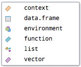

In this practice document, you will learn a bit more about RMarkdown and continue to get comfortable working with these documents. There are a variety of shortcuts and tips included as well! There are a few tasks for you to put these tips and tricks into the practice either in pairs or when working on your own. The document is written with plenty of markdown (free text) guidance between the code for independent study. 

:::{.callout-caution icon=false}
## 📝 Note 

This document contains R code to handle data and create data visualisations that we have not yet covered in the course. You are not expected to understand the code at this stage, rather focus on getting used to seeing R code and reading code comments. Starting next week we will look at how to wrangle or handle data in R.
:::

# Task 1: YAML 

Update the YAML to have the following:

1. your name in the author section
2. the date set to the system date (date when rendered) in the format DD MMM, YYYY
3. darkly theme
4. include table of contents on the left titled "Contents"
5. have the code folding option with the code showing when rendered

# Task 2: Packages

Load the `{tidyverse}` suite of packages in a code chunk called packages with the chunk option set *not* to show messages. 

```{r}
#| label: task-2
#| message: false

library(tidyverse)

```

## Tips on Navigating RStudio and Quarto Documents 

As you navigate R Studio and Quarto documents, there are a few things to draw your attention to specifically which can streamline your workflow and coding generally.

For the example data today, we will return to the [Scottish Heart Disease Statistics from Public Health Scotland](https://www.opendata.nhs.scot/dataset/scottish-heart-disease-statistics). There are 2 data sets we are interested in: 

1. [Heart Disease Activity by Health Board](https://www.opendata.nhs.scot/dataset/scottish-heart-disease-statistics/resource/748e2065-b447-4b75-99bd-f17f26f3eaef). The URL to load in the most recent version of the data: https://www.opendata.nhs.scot/dataset/0e17f3fc-9429-48aa-b1ba-2b7e55688253/resource/748e2065-b447-4b75-99bd-f17f26f3eaef/download/hd_activitybyhbr.csv


2. [Health Board look up](https://www.opendata.nhs.scot/dataset/9f942fdb-e59e-44f5-b534-d6e17229cc7b/resource/652ff726-e676-4a20-abda-435b98dd7bdc), which allows us to connect the datasets based on the Health Board codes. The URL to load in the most recent version of the data: https://www.opendata.nhs.scot/dataset/9f942fdb-e59e-44f5-b534-d6e17229cc7b/resource/652ff726-e676-4a20-abda-435b98dd7bdc/download/hb14_hb19.csv 

# Task 3: Load in data 

To load in our data, we need the `{tidyverse}` suite of package (specifically `{readr}`) loaded, which we have done in the libraries code chunk at the top. With these datasets, it is quite easy to import the data as we can use the website URLs to access the most recent version of the data.

In the code chunk below load in our two data sets and call them `activity_raw` and `hb`. Use the chunk options to *not* show the messages from reading in the data when rendering the document and be sure to give the code chunk a meaningful label. 

```{r}
#| label: import-data
#| message: false

activity_raw <- read_csv("https://www.opendata.nhs.scot/dataset/0e17f3fc-9429-48aa-b1ba-2b7e55688253/resource/748e2065-b447-4b75-99bd-f17f26f3eaef/download/hd_activitybyhbr.csv")

hb <- read_csv("https://www.opendata.nhs.scot/dataset/9f942fdb-e59e-44f5-b534-d6e17229cc7b/resource/652ff726-e676-4a20-abda-435b98dd7bdc/download/hb14_hb19.csv")
```


### Code Outputs in Quarto 

When using data that is often updated, it is crucial for reproducibility of your analyses to mention the date that you accessed the data. Below I will show you how you can use R code to include the date you last ran the code in the caption of your figure, instead of hardcoding or manually writing the date. 

```{r}
#| label: data-wrangling 

activity <- activity_raw |>
  # join activity to hb 
  left_join(hb, by = join_by("Hbr" == "HB")) |>
  # select the variables we are interested in 
  select(FinancialYear, 
         HBName, 
         AdmissionType,
         AgeGroup,
         Sex,
         Diagnosis,
         NumberOfDischarges) |>
  # reformat the financial year column to be calendar year 
  separate(FinancialYear, into = c("Year", NA), sep = "/", convert = TRUE) |>
  # filter out aggregate ALL responses from the data 
  # under 75 years is another aggregate level variable including all people under 75
  filter(Sex != "All" & AgeGroup != "All Ages" & AgeGroup != "under75 years" &
           AdmissionType != "All" & complete.cases(HBName)) |> 
  # format the Diagnosis variable for plotting later 
  mutate(Diagnosis = str_wrap(Diagnosis, width = 10))
```

You may have noticed in working through the different practice documents last week that your R output did not appear in the console or Plots tab as it does when working in Script files. 

This is because in Quarto the output of each code chunk is shown beneath that chunk of code (AKA **inline**)!

Run the following code to produce @fig-output-example, which we saw a version of in week 2's tutorial bar chart data flow demo:

```{r}
#| label: fig-output-example
#| fig-cap: "Example figure made with `{ggplot2}`"


# here I am creating an object with today's date using Sys.Date() function which takes the system date when the code is run 
date_today <- Sys.Date()

activity |>
  group_by(Diagnosis, AgeGroup) |> 
  mutate(total_discharges = sum(NumberOfDischarges, na.rm = TRUE)) |>
  ggplot(aes(x = Diagnosis, 
             y = total_discharges, 
             fill = AgeGroup)) + 
  geom_col(position = "dodge") +
  scale_y_continuous(labels = scales::label_comma()) + 
  labs(title = "Heart Disease Discharges in Scotland by Diagnsosis and Age Group",
       subtitle = "2015 - 2024",
       x = "Diagnosis",
       y = "Number of Discharges",
       fill = "Age Group",
       # add a caption with the date the data was accessed 
       caption = paste("Data source: Public Health Scotland, accessed",
                       date_today,
                       sep = " ")) +
  theme_bw()

```

If you would like to see the output in the console or Plots tab, you can run the code directly in the console. If you prefer this output style, you can change the settings by going to Tools > Global Options > R Markdown > untick "Show output inline for all R Markdown documents" 


## Other tips

* You can use the console for one off checks, but should otherwise write your code in the Quarto file for reproducibility. *Remember* any code run in the console is not saved between R sessions. 

* If you have run code previously and want to run it again or edit one part of it, go to the console and you can use the up and down arrows on your keyboard to navigate through previously executed code. 

* Use code completion to your advantage! As you type, you may have noticed that R suggests the function, data set, or variable you may be wishing to use. For variables and functions, only those which are loaded or active in your work space will be suggested.

  + You can select from the list of suggestions with your mouse, the up and down arrows on your keyboard + Tab or Enter, or start writing the function and hit Tab. 

### Task 4
  + For example, type lib into the R console pane and then press [Tab]. What are you presented with?

{fig-align="center"}

::: {.callout-caution}
Make sure that you have saved the above image file in the same folder as your .qmd file, which should also be the same folder as your .RProject file. We will discuss folder structure and related topics in more detail in the coming weeks.
:::

* Similarly, when you go to use a function, a yellow box will appear above with the arguments that the function can take. This is particularly helpful when using new functions. 

### Task 5 

Type `read_csv()` into the console to see what I mean about the yellow sticky note box with arguments. 

* In RStudio and Quarto documents, we have many different ways of specifying how our code could be run. You can run the line of code by using a **keyboard shortcut**, the options from the **run button at the top panel**, or the options within a code chunk. Within each code chunk there are two ways you can run code: 

    1. run all chunks above (particularly helpful when working in a long documents) or 
    2. run the current chunk. 

# ⌨️ Keyboard shortcuts ⌨️

You can view the keyboard shortcuts available within RStudio directly by going to Tools > Keyboard Shortcuts Help. 

You can also modify keyboard shortcuts and create your own system if you have a particular way of working in other software that you want to keep consistent. 

Assuming you keep with the existing keyboard short cuts, I have included a few of my most used shortcuts below: 

## Running code 

* IOS: Cmd + Enter

* Windows: Ctrl + Enter

## Insert an R code chunk 

* IOS: Option + Cmd + I 

* Windows: Ctrl + Atl + I 

Why don't you try it! 

## Insert a pipe operator

* IOS: Cmd + Shift + M

* Windows: Ctrl + Shift + M 

Try inserting a pipe in the code chunk that you created above. 

::: {.callout-tip}
## A note on pipes
 
This shortcut will automatically insert the `{magrittr}` pipe `%>%`, if you want to use the native base R pipe `|>` you need to change settings. Go to Tools > Global Options > Code > Editing and check the box to "Use native pipe operator, |> (requires R 4.1+)". 
:::

## Format your code for readability and general beauty 

* IOS: Cmd + Shift + A

* Windows: Ctrl + Shift + A

::: {.callout-tip}
## Tip
If you are to use this shortcut, do this before adding comments to your code 
:::

Compare the code for the plot shown below, without the helpful spacing. Not only is it less beautiful to look at, but it is also overwhelming and very difficult to read and understand what is happening. Notice though, that is does execute. It is just horrible to attempt to read. 

```{r}
#| label: messy-code

activity|>group_by(Diagnosis,AgeGroup)|>mutate(total_discharges=sum(NumberOfDischarges,na.rm=TRUE))|>ggplot(aes(x=Diagnosis,y=total_discharges,fill=AgeGroup))+geom_col(position="dodge")+scale_y_continuous(labels=scales::label_comma())+labs(title="Heart Disease Discharges in Scotland by Diagnsosis and Age Group",subtitle="2015 - 2024",x="Diagnosis",y="Number of Discharges",fill="Age Group",caption=paste("Data source: Public Health Scotland, accessed",date_today,sep = " "))+theme_bw()
```

You may also notice that when the spacing formatting is not used, the whole chunk of code is treated as a single line of code (line 221).

➡️ Try highlighting all of the code in `messy-code` and use the keyboard short cut. What do you notice? It helps, certainly, but is not as useful as intentionally formatting your code for readability as in `pretty-code`. 

It is good practice to **"let our code breathe"** and have spaces around the operators (e.g., either side of the equal sign, before a pipe, etc.). In R, you can format code by hitting "Enter" after a comma, pipe, or plus sign in `{ggplot2}` code. For readability, it is a good idea to have each line be essentially a new element or argument within the larger function. Notice how R automatically takes care of the spacing for us (so helpful!). 

```{r}
#| label: pretty-code

activity |>
  group_by(Diagnosis, AgeGroup) |> 
  mutate(total_discharges = sum(NumberOfDischarges, na.rm = TRUE)) |>
  ggplot(aes(x = Diagnosis, 
             y = total_discharges, 
             fill = AgeGroup)) + 
  geom_col(position = "dodge") +
  scale_y_continuous(labels = scales::label_comma()) + 
  labs(title = "Heart Disease Discharges in Scotland by Diagnsosis and Age Group",
       subtitle = "2015 - 2024",
       x = "Diagnosis",
       y = "Number of Discharges",
       fill = "Age Group",
       caption = paste("Data source: Public Health Scotland, accessed",
                       date_today,
                       sep = " ")) +
  theme_bw()  

```

We can see above that the code begins with the dataset `activity` being piped (which we can read in plain English as saying "and then do this") into the `groupby` function. As this is the start of our code, everything is indented for us from there. In this way, we can quickly scan the code and see that 7 functions have been used (`groupby`, `mutate`, `ggplot`, `geom_col`, `scale_y_continuous`, `labs` and `theme_minimal`).

### Task 6 

Another benefit of formatting your code like this is you can comment out specific arguments. Try to comment out the subtitle argument on line 242, rerun the code, and see what happens.

## Render a document 

If you do not want to click on the `Render` button and would prefer to stick to the keyboard the following shortcut is useful 

* IOS: Cmd + Shift + K

* Windows: Ctrl + Shift + K


That's all for now! Happy coding :) 

